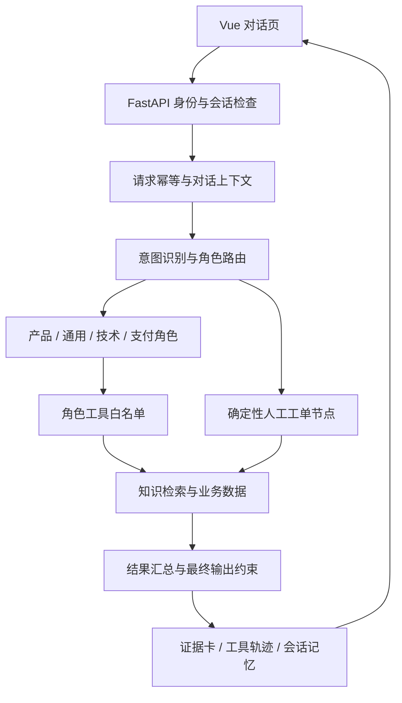

# FinClario 项目分析

## 定位与范围

金融业务咨询演示系统，由 Vue 单页应用、FastAPI 服务、角色编排与工具层、SQLite 模拟业务库组成。发布范围仅含 Python 后端和前端。Java 旧工程、求职材料、重复 wiki、私有配置不进入公开包。

这不是交易执行系统：没有申购、赎回、转账或退款通道；人工工单只写入本地队列。技术价值在于把自然语言请求转成受控业务工具调用，并展示可核验结果。

## 一次请求的完整链路

1. API 验证演示身份、输入长度和会话归属。相同请求 ID 和内容可复用响应；冲突内容被拒绝。
2. 加载最近对话与偏好。历史对话不作为当前余额、测评或交易状态的证据。
3. 意图识别结合模型、向量/本地特征与规则；演示路径使用规则。不能把规则模式的结果描述为 LLM 效果。
4. 路由决定主角色与协作角色；复杂技术/支付问题可并行处理。人工交接是确定性节点。
5. 模型模式在白名单中选择工具，校验参数并执行；工具过程按请求隔离。费用计算和所有权检查由代码完成。
6. 汇总后重新检查收益承诺、虚构资金执行、无证据产品描述、伪造工单等。关键业务事实使用确定性结果。
7. 前端展示回复、来源版本、费用与工单证据以及工具输入/输出。

## 模块拆解

| 文件/目录 | 实际实现 | 依赖与限制 |
| --- | --- | --- |
| `api/main.py` | 生命周期、聊天、产品概览、工单、知识管理、Skills、评测、指标和轨迹接口 | 全局组件与进程内会话锁；演示鉴权不是生产账户体系 |
| `core/intent_recognizer.py` | 粗细意图、紧急程度、实体提取、融合投票、缓存 | 本地兜底向量并非训练的金融语义模型 |
| `core/skill_loader.py` | Markdown/JSON Skills、匹配、摘要、提示词预算与重载 | 业务说明注入；不是隔离执行环境 |
| `agents/agent_orchestrator.py` | 多角色池、主协作决策、并行执行、响应汇总、监控降级、工具循环 | 尚无独立的单 Agent 对照实验 |
| `agents/tools.py` | 工具规格、参数校验、通用/技术/支付工具和共享知识工具 | 工具注册是进程内接口；目录名 MCP 不代表完整外部 MCP 协议服务 |
| `finance/store.py` | SQLite、模拟账户/交易/支付、Decimal 费用、会话归属和幂等工单 | SQLite UNIQUE 与事务保护重复写；不支持资金执行 |
| `finance/context.py` | 多轮费用槽位、来源轮次、更正、切换产品清理和话题中断 | 规则解析；仍需更多复杂语言样本 |
| `finance/policy.py` | 咨询/操作区分、交接请求判断、风险提示、证据约束 | 规则边界有限，不等于合规认证 |
| `finance/tools.py` / `demo.py` | 金融工具及离线规则计划器 | demo 不会调用真实模型 |
| `finance/local_runtime.py` | 本地词项召回、标题加权、产品/有效期过滤、SQLite 对话记忆 | 本地检索不是向量 RAG；摘要是历史片段整理 |
| `mcp/knowledge_base.py` | 资料校验、幂等导入、ChromaDB 检索路径 | 分布式环境及向量缓存需要另行配置 |
| `mcp/tool_manager.py` | 超时、重试、缓存、熔断、查询改写/重排及降级 | 性能收益需要实测，不能直接引用设计目标 |
| `memory/conversation_memory.py` | Redis 工作记忆、ChromaDB 情景记忆/画像、摘要 | 分布式路径保留，当前验收以本地存储为主 |
| `monitor/performance_monitor.py` | Prometheus 指标、统计、异常信号与可选 webhook | webhook 默认禁用；未进行生产容量验证 |
| `evaluation/scenario_runner.py` | 严格场景格式、实际 ASGI 接口回放、逐轮业务断言、报告 | 合成开发集，不是盲测或线上客户样本 |
| `frontend/src/App.vue` | 对话/知识/业务/评测视图、身份切换、证据卡、工具追踪 | 尚无浏览器自动化回归套件；状态集中在单组件 |

## 数据模型与业务约束

- 产品资料：`products.json`，包含产品 ID、风险、费率阶梯、来源版本和有效期。
- 业务记录：`records.json`，含固定模拟账户、交易、支付快照，按用户隔离。
- 知识资料：`knowledge.json`，区分模拟规则和教育概念，保留产品范围、来源及有效时间。
- 运行数据库：records、tickets、conversations、chat_requests；本地适配器另建 knowledge、messages、local_profiles。运行库不进入 Git。
- 金额必须是最多两位小数的十进制字符串，禁止 NaN、负数、浮点隐式输入和不支持币种；四舍五入为 ROUND_HALF_UP。
- 费用工具从当前任务及用户补充中取参数。切换产品/操作会清理过期金额与天数，不能从助手回复中编造输入。
- 工单使用数据库唯一约束去重；网络重试使用请求级幂等；工具轨迹按用户过滤。

## 两种运行方式

| 维度 | demo + local | llm + local / distributed |
| --- | --- | --- |
| 计划与意图 | 本地规则 | 模型与规则/特征融合 |
| 外部模型 | 不调用 | 需要有效提供商配置 |
| 资料与记忆 | SQLite、词项检索 | 可继续 SQLite；distributed 需 Redis/ChromaDB |
| 金额和权限 | 代码确定 | 同样由代码确定 |
| 验证意义 | 业务流程回归 | 可检验模型行为，需单独执行并保留失败 |

## 工程评价与下一步

优点是权限/金额/副作用与生成文本分离，来源证据可展示，多轮补参有明确边界，并有可回放的业务断言。不能据此声称真实模型准确率、生产级认证、金融合规资质或已上线服务。

优先后续事项：接入真正的账户鉴权与权限模型；评估多进程会话锁和持久化任务状态；执行独立模型留出集；补充真实 HTTP 负载与 Token 成本采集；验证分布式部署；拆分较大的 API/编排器/Vue 组件。依赖安全审计与升级应作为独立工作，不在此次历史整理中暗改版本。
